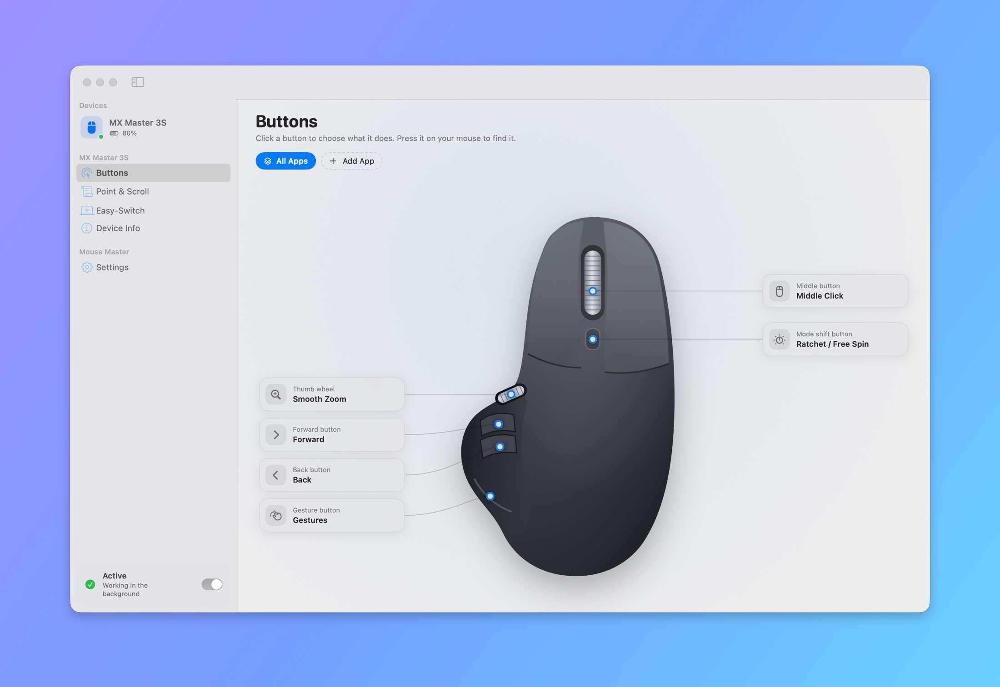
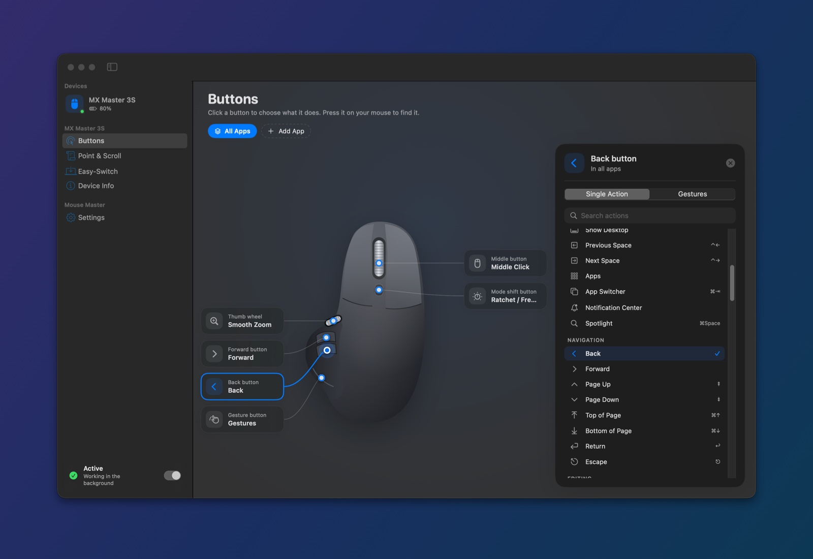
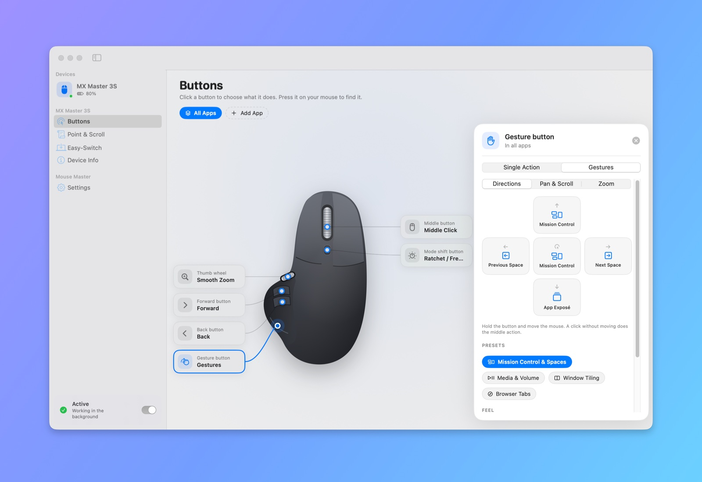
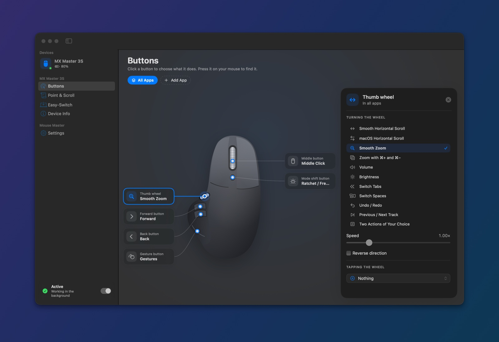
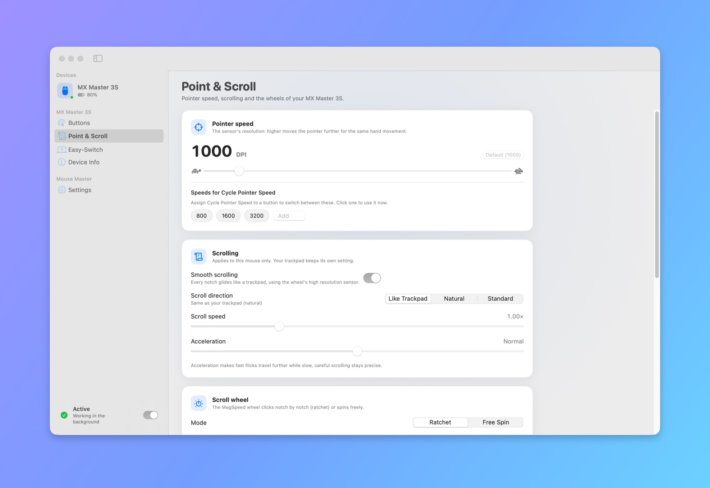
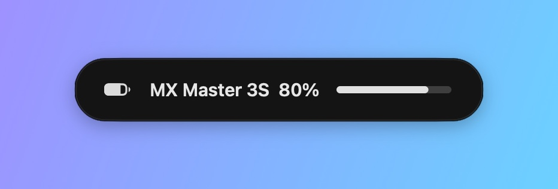

<div align="center">


# Mouse Master

### Your Logitech mouse, without Logi Options+.

Every button, gesture and wheel of your MX Master and MX Anywhere, in a tiny native Mac app.<br>
**~14 MB of memory. 0% CPU at rest. No account, no analytics, no network access. Open source.**

[](https://github.com/burakgon/mouse-master-mac/releases/latest)
[](#install)
[](#install)
[](#how-it-works)
[](LICENSE)

[**Download**](https://github.com/burakgon/mouse-master-mac/releases/latest/download/Mouse-Master.zip) · [Features](#features) · [Install](#install) · [FAQ](#faq) · [Linux version](https://github.com/burakgon/mouse-master-linux)

<br>

<picture>
  <source media="(prefers-color-scheme: dark)" srcset="docs/images/hero-dark.jpg">
  
</picture>

</div>

## Why

Logi Options+ is a web app in disguise: several always-running processes, hundreds of
megabytes of memory, an updater, analytics, and a few seconds of waiting every time the
mouse wakes up before your buttons work again.

Mouse Master talks to the mouse directly, over Logitech's own HID++ protocol, from a single
small native process. It does what you need Options+ for, and a few things it doesn't.

|                                              | **Mouse Master**            | Logi Options+                   |
| -------------------------------------------- | --------------------------- | ------------------------------- |
| Built with                                   | Swift, SwiftUI, IOKit       | Electron                        |
| Memory at rest                               | **~14 MB**, one process     | hundreds of MB, many processes  |
| CPU at rest                                  | **0%**: no timers, no polling | background activity             |
| Buttons work again after the mouse wakes up  | **in under a second**       | a few seconds                   |
| Analytics, account, network access           | **none**                    | yes                             |
| Scroll direction per mouse, trackpad untouched | ✅                        | ✅                              |
| Smooth scrolling and smooth pinch zoom       | ✅                          | ✅                              |
| Scriptable from the command line             | ✅ `mmctl`                  | —                               |
| Open source                                  | ✅ GPL-3.0                  | —                               |

## Features

<table>
<tr>
<td width="50%" valign="top">

**🖱️ Every button, any action.** Click a button on the picture of your mouse and pick what
it does: Mission Control, App Exposé, Spaces, Show Desktop, Spotlight, Notification Center,
screenshots, window tiling, media keys, brightness, tabs, copy and paste, zoom, a keyboard
shortcut, an app, a file, a website, a Shortcut, a shell command, typed text or a whole macro.
Keys stay down while you hold the button, so <kbd>⌘</kbd>-click and drag just work.

**↩️ Back and Forward everywhere.** The side buttons send <kbd>⌘</kbd><kbd>[</kbd> in apps that
expect it (Safari, Finder, App Store, Music…) and mouse buttons 4/5 everywhere else.

</td>
<td width="50%"></td>
</tr>
<tr>
<td width="50%"></td>
<td width="50%" valign="top">

**✋ Gestures.** Hold the gesture button and move: up for Mission Control, left and right for
Spaces, down for App Exposé, a click for whatever you like. Every button that can report motion
can do gestures, with presets for media and volume, window tiling and browser tabs, actions that
repeat while you move, and two extra modes: **pan** (move the mouse to scroll in any direction)
and **zoom**. The direction you just used lights up while you practise.

</td>
</tr>
<tr>
<td width="50%" valign="top">

**🌊 Smooth scrolling.** Mouse Master reads the MagSpeed wheel at full resolution and turns
every notch into a glide, like a trackpad, with your choice of speed and acceleration. Natural
or standard direction **for the mouse only**, so the trackpad keeps its own.

**🔍 Smooth zoom on the thumb wheel.** A real pinch, centred on the pointer, in Safari, Preview,
Maps, Photos, Chrome and every app that zooms with the trackpad. Or smooth sideways scrolling,
volume, brightness, tabs, Spaces, undo and redo, tracks, any two actions, and a tap action on
touch-sensitive wheels.

</td>
<td width="50%"></td>
</tr>
<tr>
<td width="50%"></td>
<td width="50%" valign="top">

**🎯 Pointer speed.** The sensor's own resolution (200 to 8000 DPI on an MX Master 3S), speeds to
cycle through from a button, and a **precision mode** that slows the pointer while you hold a
button.

**⚙️ SmartShift and the wheel.** Ratchet or free spin, how eagerly SmartShift lets go, and the
ratchet force on mice that have it (MX Master 4).

</td>
</tr>
</table>

- **🧩 Per-app setups.** Give Safari, Xcode or Photoshop their own buttons, gestures, thumb wheel
  and pointer speed. They switch the moment the app comes to the front.
- **💻 Easy-Switch.** See and rename the computers your mouse is paired with, and switch from the
  app, the menu bar or a button.
- **🔋 Battery and status in the menu bar,** a low battery notification, and a glassy on-screen
  display when the pointer speed or the wheel mode changes.

  

- **🎛️ Live.** Press a button on the mouse and it lights up in the app; turn the thumb wheel and
  it glows.
- **🪶 Never in the way.** Until macOS allows Mouse Master to act, and whenever you pause it or it
  quits, every control gets its native function back, so your mouse never stops working.
- **📡 Bluetooth, Logi Bolt, Unifying and Lightspeed receivers.** Settings follow the mouse, however
  it is connected, and come back by themselves after it sleeps or reconnects.

## Install

### Download

1. [Download **Mouse-Master.zip**](https://github.com/burakgon/mouse-master-mac/releases/latest/download/Mouse-Master.zip),
   unzip it and move **Mouse Master** into **Applications**.
2. The app is not notarized by Apple yet, so macOS stops the first launch. Either run

   ```sh
   xattr -dr com.apple.quarantine "/Applications/Mouse Master.app"
   ```

   or open it once, then click **Open Anyway** in System Settings › Privacy & Security.
3. Open Mouse Master. It walks you through the two switches macOS asks for, once:
   **Input Monitoring** (to talk to the mouse) and **Accessibility** (to press keys, click and
   scroll for you). That's it: it starts with your Mac from now on.

### Build from source

Requires macOS 14 or later and Xcode 16 or later (or the Swift 6 toolchain).

```sh
git clone https://github.com/burakgon/mouse-master-mac
cd mouse-master-mac
scripts/install.sh
```

The script builds a release, installs it into `/Applications`, registers the background service
and opens the app. Builds are signed with a local certificate that the script creates once, so
macOS keeps the permissions when you update.

## Supported mice

Mouse Master speaks HID++ 2.0 and discovers what each mouse can do, so it works with far more
mice than it has artwork for.

| Mouse | Status |
| --- | --- |
| MX Master 3S | ✅ Tested over Bluetooth |
| MX Master 4, MX Master 3 and 3 for Mac, MX Master 2S | Expected to work: same features |
| MX Anywhere 3S, 3, 2S | Expected to work, with its own artwork |
| MX Vertical, MX Ergo, Lift, M720, M650 and other HID++ 2.0 mice | Expected to work |
| Logi Bolt, Unifying and Lightspeed receivers | Expected to work |

Have one of these? [Tell us how it went](https://github.com/burakgon/mouse-master-mac/issues/new): it
helps others, and lets us add artwork for your mouse.

## FAQ

<details>
<summary><b>Can I keep Logi Options+, BetterMouse, SteerMouse, Mac Mouse Fix or LinearMouse?</b></summary>

They take over the same buttons and scroll wheel, so running two at once makes things happen
twice. Mouse Master notices when one of them is running and offers to quit it. Uninstall Logi
Options+ with its own uninstaller.
</details>

<details>
<summary><b>Why does it need Input Monitoring and Accessibility?</b></summary>

Input Monitoring is how macOS lets an app talk to a mouse over HID. Accessibility is what lets an
app press keys, click and scroll on your behalf. Mouse Master uses both for that and nothing
else: it has no network access, and no data ever leaves your Mac.
</details>

<details>
<summary><b>I allowed both, but my buttons do nothing.</b></summary>

In System Settings › Privacy & Security, switch Mouse Master off and on again under Input
Monitoring and under Accessibility. If an older copy is listed, remove it with the minus button.
`mmctl status` shows what Mouse Master sees.
</details>

<details>
<summary><b>What happens if Mouse Master crashes?</b></summary>

macOS starts it again within a couple of seconds and it picks up where it left off. When it quits
normally, or you pause it from the menu bar, every button, the wheel and the thumb wheel get
their native function back.
</details>

<details>
<summary><b>Does it use the mouse's battery?</b></summary>

No. It only talks to the mouse when you change a setting or when the mouse reports something.
</details>

<details>
<summary><b>Keyboards?</b></summary>

Not yet. MX Keys support (Fn keys, backlight, Easy-Switch) is on the roadmap.
</details>

<details>
<summary><b>How do I uninstall it?</b></summary>

Quit it from the menu bar and move it to the Trash. Your settings are in
`~/Library/Application Support/Mouse Master`.
</details>

## Command line

`mmctl` (inside the app, and on your `PATH` when installed from source) talks to the background
service:

```console
$ mmctl status
● MX Master 3S  [b034-1A2B3C4D]  Bluetooth  battery 80%
  1000 DPI · wheel ratchet · SmartShift 25 · smooth scrolling · thumb wheel handled
  middle       Middle Click
  back         Back
  forward      Forward
  gesture      Gestures
  thumbwheel   Smooth Zoom

$ mmctl set dpi=1600 scrollSpeed=1.3 scrollDirection=standard
$ mmctl bind middle mission-control
$ mmctl bind thumbwheel volume
$ mmctl watch          # live button presses and gestures
$ mmctl actions        # every built-in action
```

Fine-tune the feel without rebuilding:

```sh
defaults write com.burakgon.MouseMaster ScrollSmoothing -float 0.065      # seconds
defaults write com.burakgon.MouseMaster ScrollPointsPerNotch -float 42
defaults write com.burakgon.MouseMaster ThumbwheelPointsPerTurn -float 520
```

## How it works

```
 Logitech mouse ──── HID++ over IOKit ────▶  Mouse Master (background)  ── CGEvent ──▶ macOS
 Bluetooth, Bolt, Unifying, Lightspeed          │  ▲                     keys, clicks, smooth
                                                │  │                     scrolling, pinch zoom,
                          Unix socket, JSON     ▼  │                     system shortcuts
                                     Mouse Master (settings window) · mmctl
```

- **Diverts only what you change.** A button without an action is left alone and keeps working
  natively. Remapped buttons report their presses to Mouse Master instead of macOS, gesture
  buttons also report the mouse's motion while held, so the pointer stays still.
- **Smooth scrolling** reads the wheel in high resolution mode (15 steps per notch on the
  MX Master 3S) and posts continuous, trackpad-like scroll events spread over display frames.
- **Pinch zoom** is posted as real gesture events, so apps zoom around the pointer exactly as with
  a trackpad.
- **System actions** (Mission Control, Spaces, screenshots…) go through your own system shortcuts,
  temporarily enabled if you have turned them off, so they always work.
- **One small process.** The background service is the app itself started by launchd at login.
  The settings window is a second copy that exists only while it is open. The mouse's feature
  table is cached, so a waking mouse is ready after a handful of messages.

The code is organised as:

| | |
| --- | --- |
| `Sources/HIDPP` | HID++ 1.0 and 2.0 over IOKit: reports, request and reply matching, features, receivers |
| `Sources/AgentCore` | the background service: devices, actions, smooth scrolling and zoom, menu bar, on-screen display |
| `Sources/MouseMasterKit` | settings, actions, the gesture and wheel engines, the IPC protocol (unit tested) |
| `Sources/MouseMaster` | the SwiftUI app and the entry point of both roles |
| `Sources/mmctl` | the command line client |

## Roadmap

- MX Keys and other Logitech keyboards
- Pairing devices with Logi Bolt and Unifying receivers
- Notarized builds and a Homebrew cask
- Artwork for more mice
- Translations

## Contributing

Bug reports, device reports and pull requests are very welcome.

```sh
swift build && swift test              # build everything, run the tests
.build/debug/MouseMaster --agent -v    # the background service in a terminal, with logs
scripts/build.sh                       # build/Mouse Master.app
```

Run one background service at a time: `launchctl kill TERM gui/$(id -u)/com.burakgon.MouseMaster.Agent`
stops the installed one.

## Acknowledgements

Mouse Master builds on what the community has documented about HID++: the
[Solaar](https://github.com/pwr-Solaar/Solaar) and [logiops](https://github.com/PixlOne/logiops)
projects, Logitech's published HID++ specifications, and
[Mouse Master for Linux](https://github.com/burakgon/mouse-master-linux).

## License

GPL-3.0-or-later. See [LICENSE](LICENSE).

Logitech, Logi, MX Master, MX Anywhere, MagSpeed, SmartShift, Easy-Switch, Bolt, Unifying and
Lightspeed are trademarks of Logitech. Mouse Master is an independent project and is not affiliated
with, endorsed by or sponsored by Logitech.
